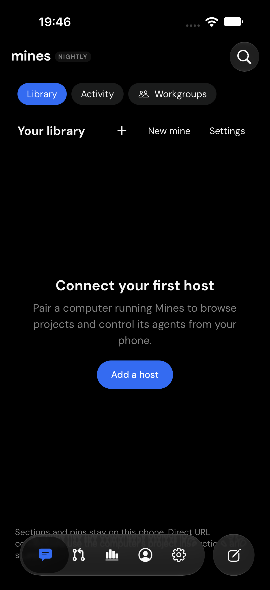
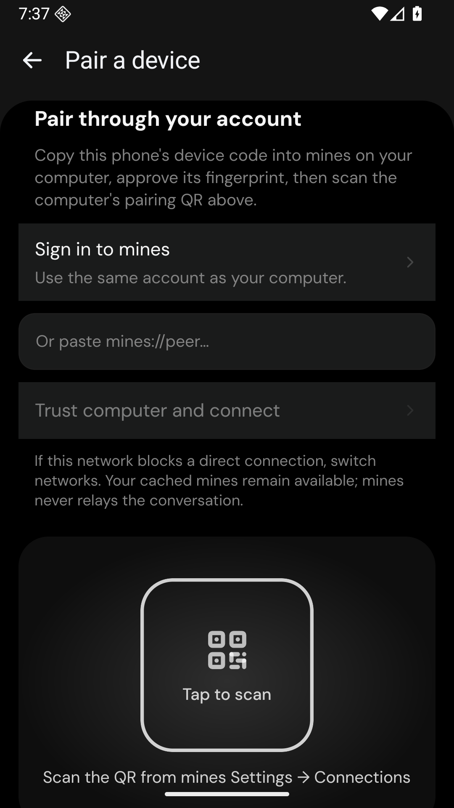

<p align="center">
  
</p>

<p align="center">
  <a href="https://github.com/mines-harness/macos/releases">Releases</a> ·
  <a href="docs/README.md">Documentation</a> ·
  <a href="docs/operations/development.md">Development</a> ·
  <a href="LICENSE">MIT license</a>
</p>

Mines is an open-source workspace for coding agents, available as an Electron desktop app, a web client, a command-line host, and native mobile companions. Keep the agent and its files on the computer that owns the work, then connect from another approved device.

Built on [T3 Code](https://github.com/pingdotgg/t3code), with provider adapters for Codex, Claude Code, Cursor, Grok, OpenCode, and Antigravity. Provider features depend on the runtime and account you connect.

## A look inside

<p align="center">
  
  
</p>

Native mobile preview captures from a simulator and emulator. These screens show the unconnected clients; they do not demonstrate a live agent session.

## Work across devices

- **One library.** Arrange mines, projects, sections, and pins. Add shared instructions and context files without moving the original workspace.
- **Agents together.** Compare models, build with reviewers, or bring existing mines into a group conversation.
- **Your provider accounts.** Use native provider runtimes and isolated profiles. Import supported conversation histories with their provenance.
- **An app for the work.** A dark desktop workspace, a browser when you need it, and iOS/Android companions for remote control.
- **Approved device connections.** Devices connect directly over authenticated WebRTC. Cached history remains available when a host is offline.

The account service coordinates identity, presence, and connection setup. Agent execution and provider credentials stay on the host. Direct access depends on the network; a sleeping host cannot serve live work. Optional public guest sharing has a separate, explicit forwarding configuration. See [remote access](docs/user/remote-access.md) and the [device-service guide](infra/mines-control/README.md).

## Source and downloads

| Repository                                                                                        | Purpose                                                                                                          |
| ------------------------------------------------------------------------------------------------- | ---------------------------------------------------------------------------------------------------------------- |
| [macos](https://github.com/mines-harness/macos)                                                   | This shared monorepo: desktop, web, server, contracts, and mobile client source.                                 |
| [windows](https://github.com/mines-harness/windows)                                               | Windows platform work and packaging.                                                                             |
| [cli](https://github.com/mines-harness/cli)                                                       | Earlier standalone host downloads and checksums; new desktop and CLI builds share the monorepo release pipeline. |
| [cli-source-private](https://github.com/mines-harness/cli-source-private)                         | Earlier CLI source snapshot; current shared host source is in this monorepo.                                     |
| [android](https://github.com/mines-harness/android) · [ios](https://github.com/mines-harness/ios) | Native mobile companion source and preview builds.                                                               |

Read each release's validation notes before installing. A source commit, a packaged download, and an installed app are separate states. Mobile previews and locally signed builds do not imply App Store distribution, notarization, or verified live provider sessions.

## Develop locally

Use the Node and pnpm versions pinned in [package.json](package.json).

```sh
pnpm install --frozen-lockfile
pnpm dev --home-dir /absolute/path/to/mines-dev
```

The dev runner prints the local URL and pairing information. `pnpm dev:desktop` starts Electron. Use an isolated development home; keep your installed app's data directory separate. Mobile development requires a native development client rather than Expo Go; see [mobile development](docs/internals/mobile-development.md).

For account and remote-device features, configure your own Mines account service using [.env.example](.env.example) and the [device-service guide](infra/mines-control/README.md). Local agent work does not require a phone or a hosted Mines account service.

Before contributing, read [CONTRIBUTING.md](CONTRIBUTING.md). Run focused tests while editing, then the changed-file checks:

```sh
pnpm exec vp run check:changed
pnpm exec vp run icons:check
```

Release maintainers: see the [unified release procedure](docs/operations/mines-release.md). Checks, artifact provenance, signing, installation, and live connection verification each have their own evidence.

## License and attribution

Mines retains T3 Code's [MIT license](LICENSE) and copyright notices. Third-party components retain their own licenses. Internal `@t3tools` package names and compatible `t3` command paths remain where required; Mines is independently maintained. The original Mines mine and flag artwork lives in [assets/mines](assets/mines).
